# dev-prompt

**A command palette for every repo you own — one that reads each project and
hands you its actual scripts, builds, and sub-packages.**

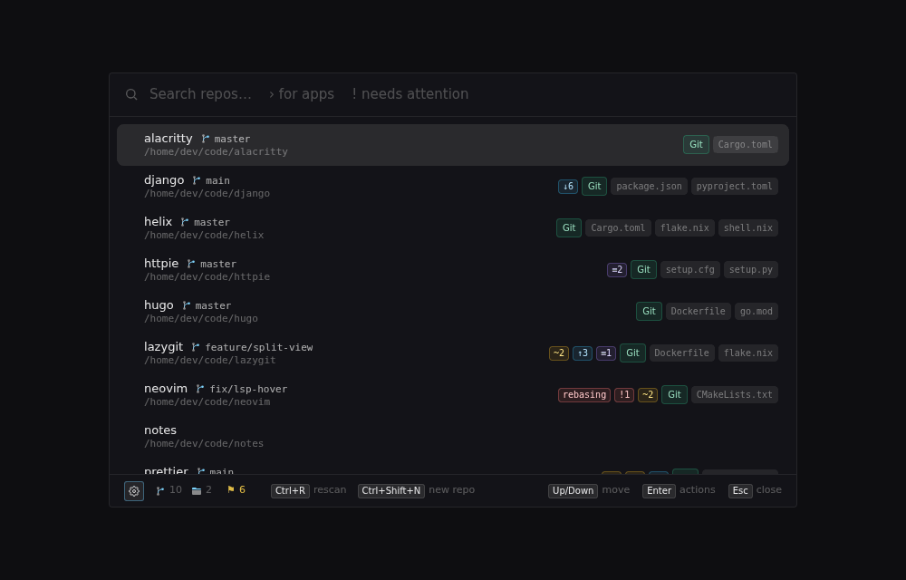

Press a global shortcut from anywhere and a fuzzy-searchable list of every
repository under your code folders appears. Type a few letters, hit `Enter`, and
that repo's action menu is up: open it in your editor or terminal, run one of
its scripts, or drop into a shell right inside the overlay.

Most launchers stop at "open the folder." dev-prompt opens the action menu it
built by _inspecting the project_: the exact `package.json` scripts it defines
(run through the right package manager), `cargo test`, the `.sln` opened in
Visual Studio, `docker compose up`, a jump straight into the `packages/api`
sub-project. No file manager, no `cd`, no remembering whether it's `npm run dev`
or `pnpm start`.

It adapts to your machine — actions for tools you haven't installed simply don't
appear — and the entire editor-and-toolchain brain is a YAML file you can extend
in a few lines. It looks after the repos themselves too: create one with version
control already set up, put an existing folder under version control, or move
one to the Recycle Bin after it checks what would be lost. Appears instantly,
vanishes the moment it loses focus, never touches your taskbar.

Cross-platform, built with **Tauri v2** (Rust) + **Svelte 5** + **Tailwind
CSS** — a small single binary with no runtime dependencies beyond the system
WebView. Website: **[seraphx2.github.io/dev-prompt](https://seraphx2.github.io/dev-prompt/)**.

## What it does

- **Global-hotkey overlay** — frameless, centered, dismiss-on-blur. Toggle with
  `Ctrl/Cmd+Backslash` (rebindable via a click-to-record field in Settings).
- **Multi-root scan + cache** — walks the directories you list, respects
  `.gitignore`, collapses nested repos, caches the result for instant startup and
  refreshes in the background when stale. A folder watcher keeps the list
  current while the app runs: a repo you clone or delete appears or goes on its
  own.
- **Fuzzy search** — fzf-style ranking over repo name, branch and path, with
  match highlighting.
- **Branch and working-copy status** — for Git, Jujutsu, Mercurial,
  Subversion, Fossil and Breezy, each repo shows what's checked out and flags
  for what exists only here or is left half-done (uncommitted changes, unpushed
  commits, stashes, a rebase stopped on a conflict, jj's conflicted and
  divergent changes, …). `!` lists just the repos that need attention; the
  action menu offers each system's safe one-keystroke steps (a fast-forward
  pull, push, publish, fetch, update, sync, the branch on GitHub / GitLab / …)
  and a branch switcher that also makes worktrees, workspaces, shares and
  checkouts. Everything else hands off to your GUI. See
  [`docs/vcs-status.md`](docs/vcs-status.md).
- **Context detection** — on selecting a repo it inspects the tree (root plus
  side-by-side and `packages/*`-style sub-projects) for `.sln` / `.csproj`,
  `package.json` scripts, `Cargo.toml`, `go.mod` / `go.work`, Python
  (`pyproject.toml` / `requirements.txt`, uv / poetry), `docker-compose`, and more.
- **Config-driven rule engine** — every editor / build-tool / launcher mapping
  lives in a bundled `default_config.yaml` (markers, program resolution, rules,
  universal actions). A hand-edited `rules.yaml` layers your own on top.
- **Action menu** — always-available actions (terminal, file manager, copy path)
  first, then detected per-ecosystem actions; multi-project repos collapse into
  drill-in submenus. Actions gracefully disappear when the tool they need isn't
  installed.
- **Built-in shell** — **Open shell** (`Ctrl+R` in the action menu) opens
  your own shell (pwsh, bash, zsh, fish, nu, …) right in the overlay, at the
  repo. It keeps running when you hide the overlay, so a dev server stays up and
  the hotkey brings you straight back to it. Every running shell is one `$` (or
  a footer click) away, to jump into or close.
- **Repo management** — **New repository** (`Ctrl+Shift+N`) creates a folder
  with Git, Jujutsu, Mercurial, Breezy or Darcs set up; **Set up version
  control…** does the same for a folder that has none; **Move to Recycle Bin**
  checks for unpushed commits and uncommitted work first, and offers Undo.
- **App launcher** — type `>` to search your installed applications instead of
  repos (Start Menu, Store and installed programs on Windows; `.desktop`
  entries on Linux), most-used first.
- **Right-click menus** — on repos, apps, actions and the shell: the useful
  options for each, styled like the rest of the app.
- **Settings screen** — a sidebar of pages (General, Repos, Tools, Apps, the
  rules viewer / tracer / icon list, About) that saves each change as you make
  it. Reachable from the overlay (`Ctrl+,`) or the tray icon.
- **System tray** — Show / Settings / Close all shells / Quit; the overlay otherwise has no taskbar
  presence.
- **In-app auto-update** — checks GitHub Releases, downloads and installs signed
  updates, relaunches. See [`docs/releasing.md`](docs/releasing.md).

## Install

**Windows** — grab `dev-prompt_<version>_x64-setup.exe` (or the portable zip)
from the [latest release](https://github.com/seraphx2/dev-prompt/releases/latest).

**Linux** — a signed package repo covers apt / dnf / pacman / Flatpak
([`docs/linux-distribution/`](docs/linux-distribution/README.md)); updates then
ride your normal `apt` / `dnf` / `pacman -Syu` / `flatpak update`. Or take the
`.AppImage` from the release and run it directly.

<details><summary>Debian / Ubuntu / Mint</summary>

```sh
curl -fsSL https://seraphx2.github.io/dev-prompt/dev-prompt.asc \
  | sudo gpg --dearmor -o /usr/share/keyrings/dev-prompt.gpg
echo "deb [signed-by=/usr/share/keyrings/dev-prompt.gpg] https://seraphx2.github.io/dev-prompt/deb stable main" \
  | sudo tee /etc/apt/sources.list.d/dev-prompt.list
sudo apt update && sudo apt install dev-prompt
```
</details>

<details><summary>Fedora / RHEL</summary>

```sh
sudo tee /etc/yum.repos.d/dev-prompt.repo <<'EOF'
[dev-prompt]
name=dev-prompt
baseurl=https://seraphx2.github.io/dev-prompt/rpm
enabled=1
gpgcheck=1
gpgkey=https://seraphx2.github.io/dev-prompt/dev-prompt.asc
EOF
sudo dnf install dev-prompt
```
</details>

<details><summary>Arch / CachyOS / Manjaro</summary>

```sh
curl -fsSL https://seraphx2.github.io/dev-prompt/dev-prompt.asc | sudo pacman-key --add -
sudo pacman-key --lsign-key E3C07CD21A9A9BA5
sudo tee -a /etc/pacman.conf <<'EOF'

[dev-prompt]
SigLevel = Required
Server = https://seraphx2.github.io/dev-prompt/arch
EOF
sudo pacman -Sy dev-prompt
```
</details>

<details><summary>Flatpak (any distro)</summary>

```sh
# one-time: the GNOME runtime comes from Flathub
flatpak remote-add --if-not-exists flathub https://flathub.org/repo/flathub.flatpakrepo

flatpak remote-add --if-not-exists --user dev-prompt \
  https://seraphx2.github.io/dev-prompt/dev-prompt.flatpakrepo
flatpak install --user dev-prompt io.github.seraphx2.devprompt
```

Or open
[`io.github.seraphx2.devprompt.flatpakref`](https://seraphx2.github.io/dev-prompt/io.github.seraphx2.devprompt.flatpakref)
in your software centre for a one-click install. This is a self-hosted remote,
not Flathub — see [`docs/linux-distribution/phase-4-flatpak.md`](docs/linux-distribution/phase-4-flatpak.md).
</details>

## Configuration

First run creates two files in your OS config directory (`%APPDATA%\dev-prompt\`
or `~/.config/dev-prompt/`):

- **`config.yaml`** — your settings (hotkey, roots, scan depth, cache lifetime).
  Managed entirely by the **Settings** screen; you don't normally touch it.
- **`rules.yaml`** — overrides for the rule engine: extra `markers`, `programs`,
  `rules`, and `universal` actions layered over the bundled defaults. Hand-edited
  (Settings ▸ Active rules ▸ Open rules file), ships as a commented scaffold.

Settings reference: [`docs/configuration.md`](docs/configuration.md). The rule
engine — merge rules, every field, and worked examples (pin an editor path, add a
build rule, disable a built-in, change the Enter action) —
[`docs/rules-engine.md`](docs/rules-engine.md); the canonical schema with inline
docs is [`src-tauri/src/default_config.yaml`](src-tauri/src/default_config.yaml).

The discovered repo list is cached at `<OS cache dir>/dev-prompt/repos.json`; the
installed-app list (`>` scope) is cached alongside it at
`<OS cache dir>/dev-prompt/apps.json`.

### How detection works

1. **Discovery** — a directory is a "repo" if it contains any `markers` entry
   _or_ matches any rule's `match` glob (`.git`, `*.sln`, `package.json`,
   `Cargo.toml`, `pom.xml`, `Gemfile`, …). Every folder directly inside a root
   is listed too, marker or not (Settings ▸ Repos ▸ "List every folder directly
   inside a root"), unless it only holds other repos. While the app runs, the roots
   are watched, so repos created, deleted or moved in show up within a second
   or so.
2. **Inspection** — on selection, the repo tree is read for project manifests and
   their details (scripts, package manager, Python runner, compose files).
3. **Rules** — `default_config.yaml` maps manifests to actions. `requires: [bin]`
   hides a rule unless the binary is on `PATH`; `needs: [key]` hides an action
   unless that program resolves. Nothing errors when a tool is missing — it just
   doesn't appear.

## Platform support

|                   | Status                                                                                                                                                                                                                                                                                                                     |
| ----------------- | -------------------------------------------------------------------------------------------------------------------------------------------------------------------------------------------------------------------------------------------------------------------------------------------------------------------------- |
| **Windows 10/11** | Built, packaged (NSIS installer + portable zip), and tested. Acrylic blur + rounded corners, Windows Terminal integration, Visual Studio / Rider detection.                                                                                                                                                                |
| **Linux**         | Same codebase, compiles. Built and packaged (`deb` / `rpm` / `AppImage` + a signed apt/dnf/pacman repo and a self-hosted Flatpak) by the release workflow; AppImage installs auto-update, everything else updates through its package manager. Hotkey works on X11; Wayland needs the XDG global-shortcuts portal (tray-click fallback otherwise). The `>` app launcher reads freedesktop `.desktop` entries (theme icons, `gtk-launch`). Terminal-command actions need per-emulator working-dir flags (in progress) — plain "open a terminal" works. Panel is translucent but unblurred (no compositor backing yet), so it paints a little more solid than on Windows. On Wayland the overlay is a layer-shell surface, kept centred by the compositor (KDE, Sway, Hyprland, …), when `gtk-layer-shell` is installed (the packages recommend it; the Flatpak bundles it); GNOME, which lacks layer shell, places it as a regular window. |

Windows and Linux are the only supported targets — see [`CLAUDE.md`](CLAUDE.md).
The architecture is still platform-neutral where it costs nothing — program
paths and OS quirks are isolated in the `programs` config (`any` / `windows` /
`linux` candidate lists) and a handful of `#[cfg]` blocks. The remaining
cross-platform work is tracked in
[`docs/future-work.md`](docs/future-work.md).

## Prerequisites

| Tool                 | Notes                                                                                                                                                                                                                               |
| -------------------- | ----------------------------------------------------------------------------------------------------------------------------------------------------------------------------------------------------------------------------------- |
| Node.js 22+ (`.nvmrc` pins 24; CI builds on 24) | frontend build (`npm`)                                                                                                                                                                             |
| Rust (stable, 1.77+) | <https://rustup.rs>                                                                                                                                                                                                                 |
| Platform toolchain   | **Windows:** MSVC Build Tools ("Desktop development with C++") + WebView2 (preinstalled on Win 11). **Linux:** `webkit2gtk-4.1`, `libayatana-appindicator3`, `librsvg2`, standard build tools. |

## Run (development)

```sh
npm install
npm run tauri dev
```

Starts Vite on :1420 and launches the overlay (hidden until you press the
hotkey). The tray icon appears immediately.

## Build

```sh
npm run tauri build
```

Produces a Windows NSIS installer, or the Linux `deb` / `rpm` / `AppImage`
bundles, depending on the host OS. The release workflow builds both — see
[`docs/releasing.md`](docs/releasing.md), which also has a recipe for
smoke-testing a Linux bundle locally.

## Usage

dev-prompt is meant to sit in the background and be summoned by its hotkey, so
turn on **Settings ▸ General ▸ Start at login** — then the hotkey is live from every boot
and the app is never a window you have to find. (On Flatpak your desktop asks
permission the first time; on the AppImage there's no autostart hook, so add one
via your desktop's session settings.)

**Repo list**

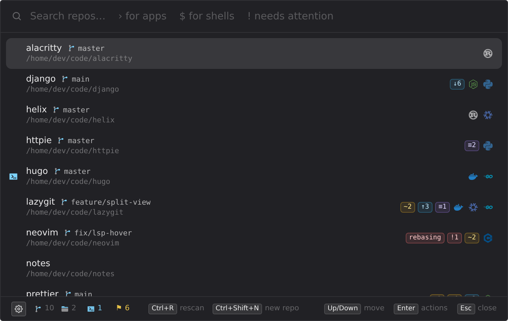

| Key                  | Action                                                |
| -------------------- | ----------------------------------------------------- |
| type                 | fuzzy-filter repos                                    |
| `Up` / `Down`        | move selection                                        |
| `Enter`              | open the action menu for the selected repo            |
| `>`                  | search installed apps instead (see below)             |
| `$`                  | list the running shells (see below)                   |
| `!`                  | list only the repos that need attention (see below)   |
| `Ctrl+R`             | force a rescan                                        |
| `Ctrl+Shift+N`       | create a new repository (see below)                   |
| `Delete`             | clear the query                                       |
| `Ctrl+Delete`        | move the selected repo to the Recycle Bin (see below) |
| `Ctrl+,`             | open Settings                                         |
| `Esc` / click away   | hide the overlay                                      |

Small icons on each row say what kind of project it is — Rust, Node, Python,
Docker, .NET, … (hover one for the files that say so). A repo that isn't Git
also shows its version control by command name: `jj`, `hg`, `svn`, `fossil`,
`brz`, `darcs`.

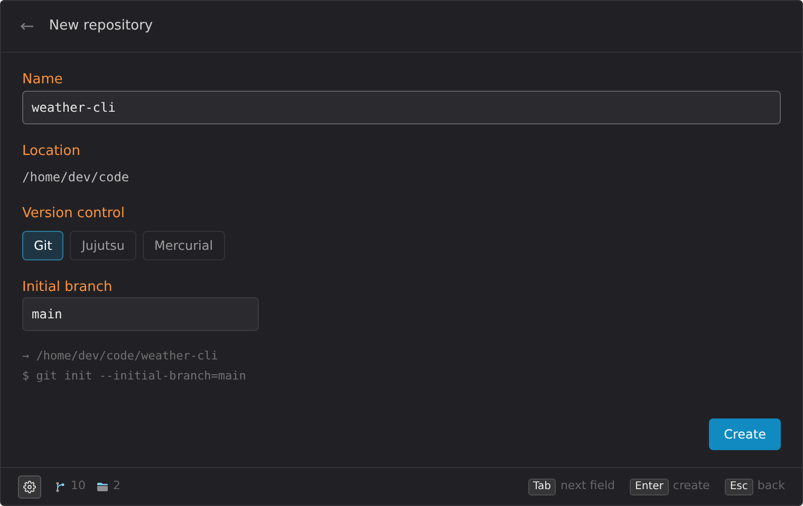

**New repository** (`Ctrl+Shift+N`) creates a folder in one of your roots and
sets up version control in it — Git, Jujutsu, Mercurial, Breezy or Darcs,
whichever are installed — then opens its action menu. Pick a name, a root (if
you have more than one) and a tool; `Tab` moves between fields, `Enter`
creates, `Esc` goes back. If setup fails, the error is shown and the folder is
removed again. No remotes are set up; do that from your terminal or editor.

A folder that isn't under version control yet (notes, documents, a project you
haven't set up) shows up without a branch, and its action menu offers **Set up
version control…** — the same form, for that folder. If setup fails, only what
it added is removed; nothing already in the folder is touched.
Subversion isn't offered — see
[docs/rules-engine.md](docs/rules-engine.md#subversion-in-new-repository) for
why, and how to add it anyway.

**Action menu**

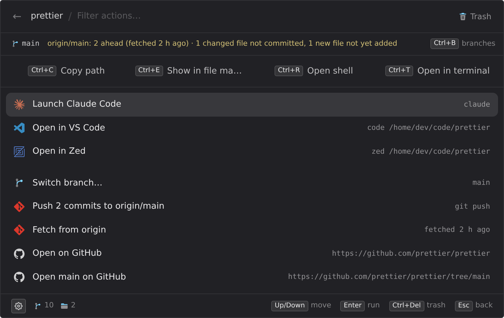

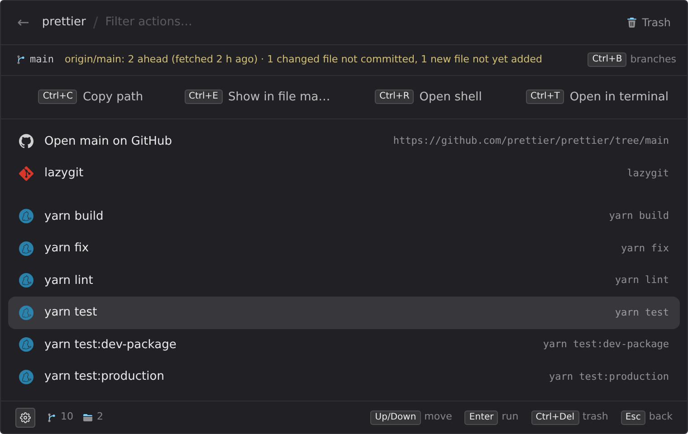

| Key      | Action                                               |
| -------- | ---------------------------------------------------- |
| type     | filter actions (reaches into sub-projects)           |
| `Enter`  | run the selected action, or drill into a sub-project |
| `Tab`    | drill into the selected sub-project                  |
| `Ctrl+T` | open in your terminal app                            |
| `Ctrl+E` | show in your file manager                            |
| `Ctrl+C` | copy the path                                        |
| `Ctrl+R` | open a shell in the overlay (see below)              |
| `Ctrl+B` | switch branch / bookmark, or open one in a new worktree, workspace, share or checkout |
| `Ctrl+Delete` | move this repo to the Recycle Bin (see below)   |
| `Esc`    | step back one level (sub-project → menu → repo list) |

The four quick actions also sit as buttons along the top of the menu.

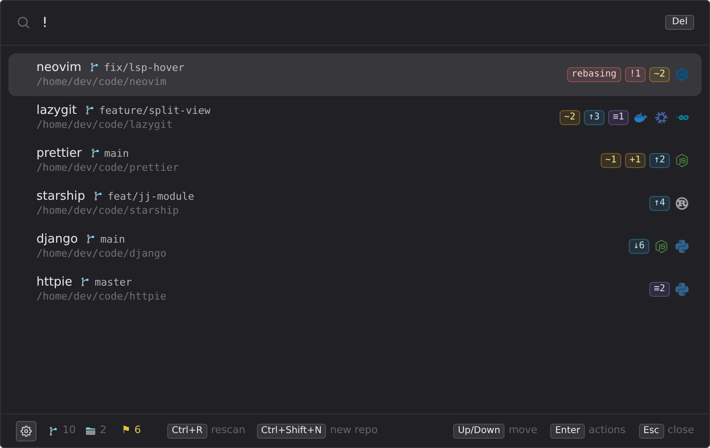

**Branches and status** — each repo row shows what's checked out (a branch, a
bookmark, `main +2` for Jujutsu changes on top of one) and flags for what
exists only on this machine or is left half-done: `~3` changed files, `+1` new
ones, `↑2` unpushed commits (drafts, unsent check-ins), `↓4` behind the
upstream, `≡1` a stash or shelf, `rebasing` / `merging` / … with `!1`
conflicts, jj's `!1ch` conflicted changes and `divergent`, `stale`, `needs
cleanup`, `detached`, `gone`, `local` (hover any of them for the sentence).
That works for Git, Jujutsu, Mercurial, Subversion, Fossil and Breezy, each in
its own terms, and stays current in the background as you work. The footer
counts the repos that need attention — click it, or type `!`, for just those,
most urgent first. The search also matches branch names, so a ticket number
finds every repo on that ticket.

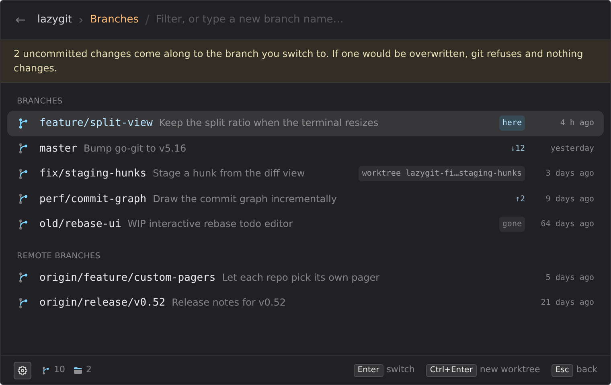

In the action menu a line under the header spells the state out, and a
**Version control** section offers only what's safe in one keystroke right
now: for Git a fast-forward **Pull**, a **Push** to the branch's upstream,
**Publish** a branch that has none, **Fetch**; for Jujutsu push / publish a
bookmark and fetch; Mercurial's pull and push of drafts; Subversion's update;
Fossil's sync and update; Breezy's pull and push; and the repo, branch and new
pull request on GitHub, GitLab, Bitbucket, Azure DevOps or Codeberg. `Ctrl+B`
opens the branch switcher: `Enter` switches (never forced, and never merging
uncommitted work in), `Ctrl+Enter` checks the branch out in a second working
copy beside the repo instead — a Git worktree, a jj workspace, a Mercurial
share, a Subversion or Fossil checkout — and typing a new name creates it.
Staging, committing, diffs and conflicts are your GUI's job — Fork, GitKraken,
Sublime Merge, Git Extensions, GitHub Desktop, TortoiseGit, gitg, lazygit,
gitui and tig are offered when installed. More in
[docs/vcs-status.md](docs/vcs-status.md), including a script that builds a
test repo for every state of every system.

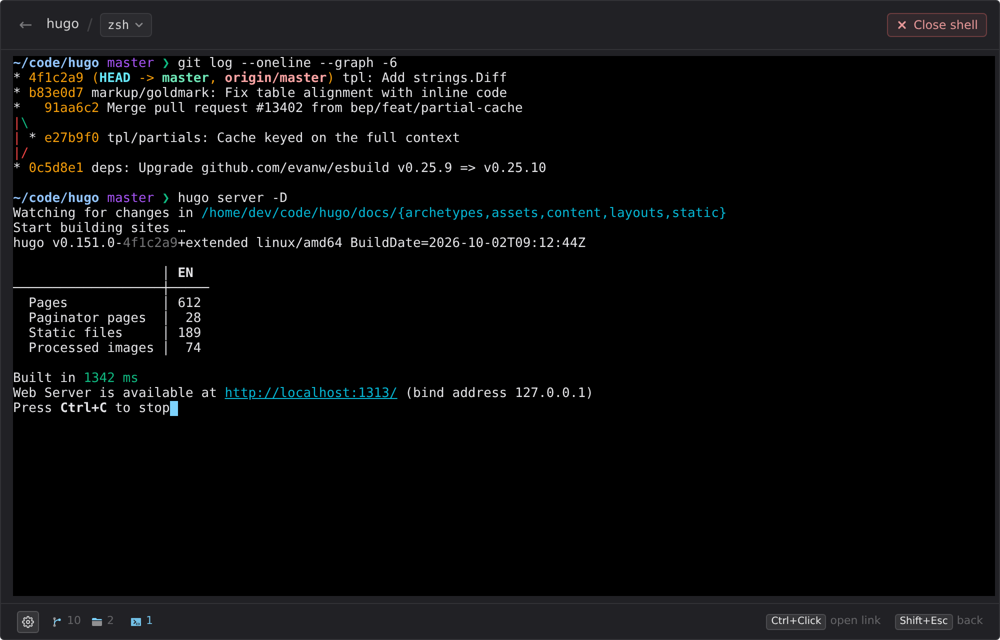

**Open shell** (`Ctrl+R` in the action menu, or a repo's right-click menu)
opens a shell inside the overlay, in that repo — your own shell, with your
profile, prompt, history and tab completion. It's a full terminal: colours,
`vim`, `fzf`, progress bars and Ctrl+C all work. The overlay grows while it's
open.

| Key                       | Action                                               |
| ------------------------- | ---------------------------------------------------- |
| everything, `Esc` too     | goes to the shell                                    |
| `Shift+Esc` / mouse back  | step back to the action menu (the shell keeps running) |
| the hotkey                | hide the overlay; press it again to come back to the shell |
| `Ctrl+C` with a selection | copy (`Ctrl+Shift+C` always copies)                  |
| `Ctrl+V` / `Ctrl+Shift+V` | paste                                                |
| `Ctrl`+click a link       | open it in your browser                              |

Each folder gets one shell. Leave it and it keeps running — a blue terminal
icon to the left of the repo's name says so — and Open shell goes back to it. The shell's name in
the header switches to another shell (Settings ▸ Tools ▸ Shell sets the
default); **Close shell** stops it and whatever it's running, like closing a terminal
tab. Typing `exit` closes it too. If it exits with an error, the output stays
up: `Enter` starts it again. Settings ▸ Tools also sets its font — pick a
[Nerd Font](https://www.nerdfonts.com/) if your prompt uses icons.

**Running shells** — while any are open, a terminal icon with a count sits in
the footer. Click it, or type `$` in the search box, for a list of every shell
across all your repos:

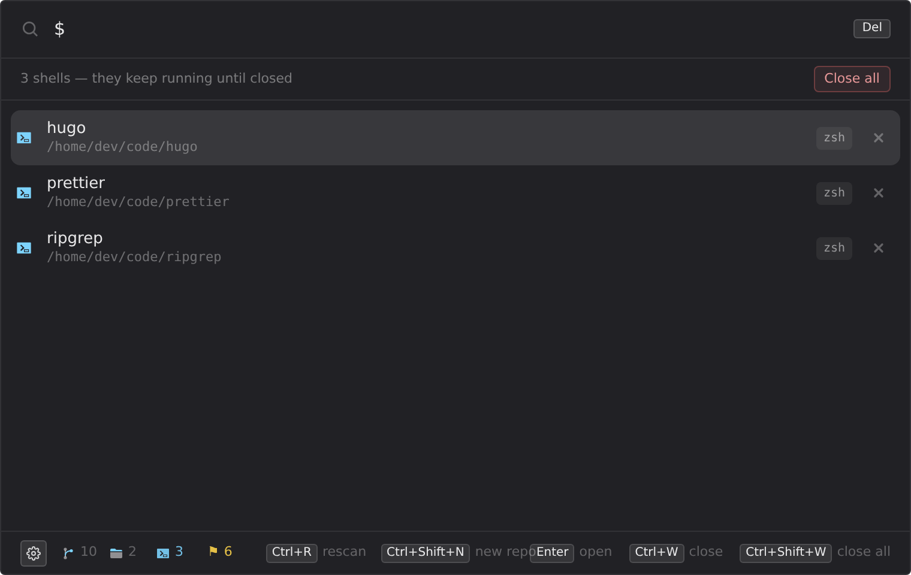

| Key                  | Action                                     |
| -------------------- | ------------------------------------------ |
| type after `$`       | filter by repo name or folder              |
| `Enter` / click      | go into that shell                         |
| `Ctrl+W` / its ✕     | close that shell                           |
| `Ctrl+Shift+W` / **Close all** | close every shell                |

A repo's right-click menu has **Close shell** while one runs there, and the
tray icon's **Close all shells** clears them without opening the overlay.

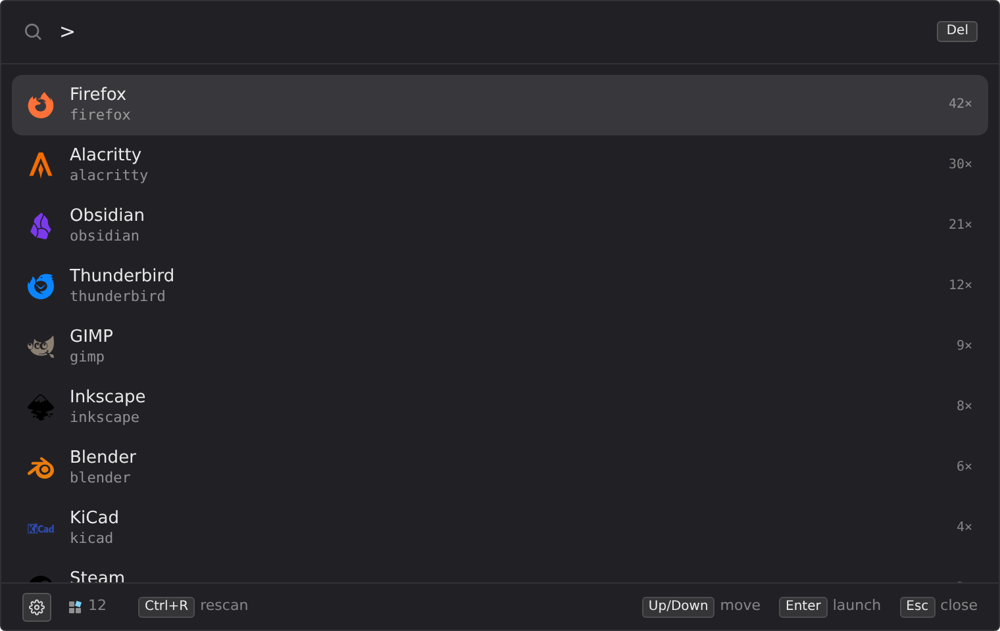

**Apps** — a leading `>` in the search box swaps the repo list for your
installed applications: type to filter, `Enter` launches, most-used first. A
second hotkey (Settings ▸ General) opens straight into it. Settings ▸ Apps adds
folders to index or turns the whole scope off.

**Right-click** works where it's useful, styled like the rest of the app:

- a **repo** — open its actions, "Switch branch…" for Git, its quick actions
  (terminal, file manager, copy path, open shell), "Set up version control…"
  when it has none, the
  actions you use most in that repo, "Close shell" while one runs there, and
  "Move to Recycle Bin…" (see below);
- an **app** in `>` — launch it, show its folder, copy its path;
- an **action** — run it, or copy the command it would run;
- the **shell** — copy, paste, clear, restart or close it;
- a **text field** — cut, copy, paste, select all.

Anywhere else right-click does nothing — the browser's own Back / Reload /
Print menu never shows. (In a dev build, Shift+right-click still opens it, for
Inspect.)

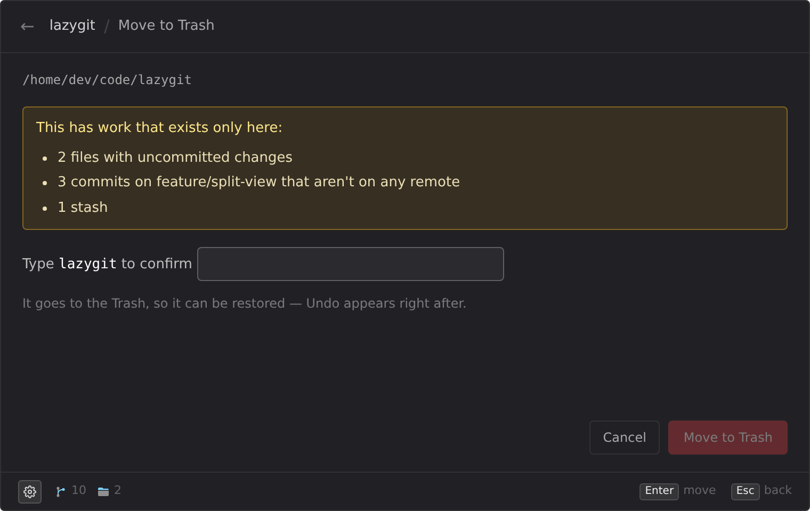

**Move to Recycle Bin** (Trash on Linux) — the **Recycle** button in a repo's
action menu header, `Ctrl+Delete` there or on a selected repo in the list, or
the repo's right-click menu — never deletes outright: the folder goes to the bin, Undo
(`Ctrl+Z`) appears right after, and on Windows a folder too big for the bin
gets Windows' own "permanently delete?" prompt rather than vanishing. First it
checks what exists nowhere else: uncommitted changes, commits on no remote,
stashes / shelves, repos nested inside, or no version control at all. A clean
repo whose commits are all on a remote is one click; anything else lists what's
at risk and asks you to type the folder's name. Git, Jujutsu, Mercurial and
Fossil are checked fully offline; Subversion commits go straight to the
server, so only local changes can be lost there; Breezy and Darcs can only
tell what was pushed by asking the remote, so those always ask for the name.
Your root folders themselves are never offered.

The mouse **back / forward** buttons work throughout: back == `Esc` for the
current screen, forward == open the action menu on the repo list, or drill
into a sub-project from within it.

## Releasing

Manual GitHub Actions workflow computes a CalVer version, builds, and publishes a
release with the installer, a portable zip, and signed updater artifacts. Full
details — versioning, the draft/prerelease toggles, the one-time signing-key
setup — in [`docs/releasing.md`](docs/releasing.md).

## Contributing

Issues and PRs welcome. Adding support for an editor or build tool is usually
just data in `default_config.yaml` — no Rust. See
[`CONTRIBUTING.md`](CONTRIBUTING.md).

## Project layout

```
src/                        Svelte frontend (overlay UI)
  App.svelte                repo / app / shell lists, action menu, screens, window-level keys
  lib/ipc.ts                typed wrappers over Tauri commands + events
  lib/fuzzy.ts              fzf-style scorer
  lib/shells.svelte.ts      built-in shell sessions (xterm.js), one per folder
  lib/shellKeys.ts          which keys go to the shell and which to the app
  lib/updater.ts            auto-update check / install
  lib/components/           SearchInput, ResultList, AppList, ShellList, ActionMenu,
                            Shell, NewRepo, RemoveFolder, ContextMenu, …
  lib/components/settings/  the Settings shell (sidebar + autosave) and one
                            component per page
src-tauri/                  Rust backend
  src/config.rs             config schema, load/merge, path expansion
  src/default_config.yaml   bundled markers / programs / rules / universal
  src/scan.rs               directory walk -> Vec<Repo>, discovery globset
  src/watch.rs              folder watcher: rescans when repos come or go
  src/inspect.rs            per-repo context (projects, manifests, compose)
  src/rules.rs              rule engine: program resolver, templates, providers
  src/cache.rs              repos.json / apps.json read/write, staleness, merge
  src/index.rs              nucleo fuzzy ranking
  src/apps.rs               installed-app discovery for the > scope
  src/app_watch.rs          app watcher: Start Menu / registry / .desktop changes
  src/provision.rs          New repository / Set up version control
  src/removal.rs            Move to Recycle Bin: the at-risk check, Undo
  src/vcs_state.rs          a working copy's state, every system: branch, changes, unpushed, stashes, …
  src/status.rs             keeps every repo's state current in the background
  src/vcs_ops.rs            branches, switching, second working copies, remote steps, web links
  src/*_ops.rs              each system's side of it: git, jj, hg, svn, fossil, brz
  src/pty.rs                built-in shell: the user's shell in a pseudo-terminal
  src/launch.rs             detached process spawning
  src/layer.rs              Wayland: the overlay as a centred layer-shell surface
  src/commands.rs           #[tauri::command] surface + shared state
  src/lib.rs                plugin wiring, window setup, hotkey, tray
  src/rules_template.yaml    scaffold written to the user's rules.yaml
scripts/version.mjs         CalVer generator for releases
packaging/                  Linux packaging: .desktop / AppStream, PKGBUILDs,
                            Flatpak manifest, the apt/rpm/pacman repo builder,
                            and the website (packaging/site/)
.github/workflows/          CI, release, the package repo, dev sync
docs/                       configuration.md, rules-engine.md, vcs-status.md, releasing.md, future-work.md
```

## Tests

```sh
cd src-tauri && cargo test    # config merge/expansion, discovery,
                              # nested-repo collapse, cache staleness,
                              # rule evaluation, fuzzy ranking, the watchers
                              # against real OS events, shell sessions in a
                              # real pseudo-terminal
npm run test                  # frontend logic (fuzzy, hotkeys, shell keys,
                              # settings model)
npm run check                 # svelte-check (types)
```

## License

MIT — see [LICENSE](LICENSE).

## Install note

The Windows installer is unsigned, so SmartScreen shows a warning on first run —
**More info ▸ Run anyway**. Updater artifacts are minisign-signed (public key in
`src-tauri/tauri.conf.json`); the app verifies every update before applying it.
